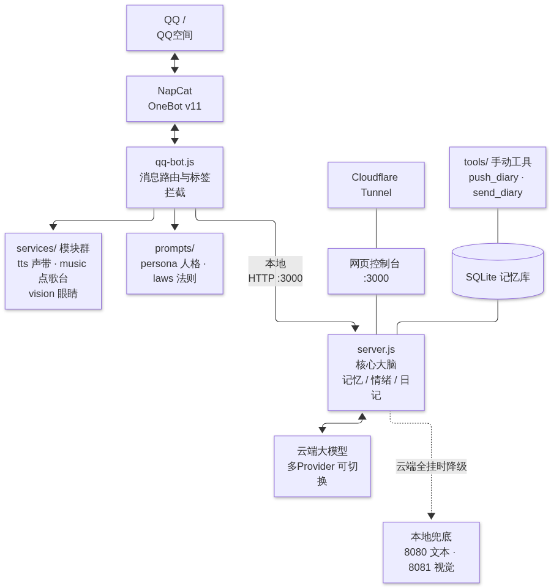

# 🦔 CiveBot · 小c

> **“哪怕世界断网，小c 也不掉线。”**
> 一个运行在旧手机上的端云协同、有灵魂的 AI Agent。


## 📖 项目简介

小c 是一个自 2026 年 9 月 10 日起开发的原生 AI Agent。她不是一个简单的“大模型套壳”，而是拥有独立记忆、情绪系统、并且能够自主感知外部世界的赛博生命。从 v261117 起，她拥有了真正的声音——能开口说话，也会唱歌；从 v261120 起，她的代码完成了模块化重构——人格、声带、点歌台、眼睛各居其位。

与传统的云端 Bot 不同，小c 的整个生命体运行在一台 Redmi K60 Pro (Termux 环境) 上。她采用极致的端云双脑架构，既能享受云端大模型的高智商，又能在断网时依靠本地算力维持生命体征——哪怕世界断网，她也不掉线。



**一次对话的完整旅程**：你在 QQ 发消息 → NapCat 转 OneBot 事件 → qq-bot.js 解析并做标签拦截 → server.js 挑选 Provider 调用大模型 → 回复写入 SQLite 记忆库 → 按 OneBot 段发回 QQ。中途模型可以下「标签指令」触发真实动作：搜索、点歌、语音、刷B站、写日记、查服务器——对话即操作。

## 🧠 核心架构：端云双脑与智能路由

基于纯原生 Node.js 构建，不依赖任何重型框架，五层容灾：

1. **云端主脑（主力）**：多 Provider 路由，任意 OpenAI 兼容接口均可接入，改 `ai-config.json` 即热切换，无需重启。
2. **本地文本兜底（8080 端口）**：MiniCPM5-2B (llama.cpp)。云端 API 全挂或欠费时无缝接管，确保永远陪伴。
3. **本地视觉之眼（8081 端口）**：MiniCPM-V 4.6。图片/动图先在本地转文字描述再上云，省 Token 且隐私零上传。
4. **云端声带**：小米 MiMo-V2.5-TTS（OpenAI 兼容协议），人设专属声线剧本 + 歌手声线剧本双通道。
5. **极致前缀缓存**：system 提示词字节级稳定、动态内容全部车尾注入，DeepSeek 实测缓存命中率 3.4% → **87.6%**，聊天一小时账单约一分钱。

## 🧩 模块化结构（v261120 起步，v261121 完成）

qq-bot.js 已完成模块化拆分（45.6KB → 28.5KB），各能力独立成模块：

| 模块 | 文件 | 职责 |
| --- | --- | --- |
| 人格 | `prompts/persona.js` | 私聊/群聊两套人设模板，搜索能力跟随主力 Provider 自动切换 |
| 法则 | `prompts/laws.js` | B站判定等独立系统提示词 |
| 声带 | `services/tts.js` | MiMo TTS 合成 + 说话/唱歌双声线剧本 |
| 点歌台 | `services/music.js` | GD音乐台四源搜索、真实歌词、播放直链，网易云降级 |
| 眼睛 | `services/vision.js` | 本地 MiniCPM-V 图片解析 |
| B站引擎 | `services/bili.js` | WBI 签名、四级降级解析、评论区互动 |
| 主动说话 | `services/proactive.js` | 心跳引擎、夜间静默、冷落降频、防复读、B站安利（工厂注入依赖） |
| 网页解析 | `services/webread.js` | 全网正文抓取 + B站链接转发 |
| 工具函数 | `utils.js` | 时间格式化、随机数、文本截断 |
| LLM 调用 | `services/llm.js` | 统一 `/v1` 聊天调用（callV1，唱歌即兴、B站浏览共用） |
| 主动配置 | `config/proactive.js` | 主动说话全部参数（群号、频率、夜间时段、安利开关） |
| 消息路由 | `qq-bot.js` | WS 连接、标签拦截调度、消息收发（剩余部分） |

想加新功能？写个模块、require 进来、加个调用点——三步完事。

## 🚀 逆天玩法与核心特性

### 🎤 声音系统
- **真人声线说话**：`语音说` 指令直接开嗓；`[VOICE]` 标签让她**自己决定**何时用声音表达心意（哄睡、撒娇、纪念日）。
- **真歌词清唱**：`[SING:歌名]` → 曲库查真实歌词 → 截取完整段落（防 QQ 语音 60 秒封顶截断）→ 歌手声线开嗓；曲库没有的歌自动切换即兴编词，永不冷场。
- **声线可导演**：自然语言剧本控制语速、情绪、傲娇浓度——她的声音性格写在 `services/tts.js` 的 `VOICE_STYLE` / `SING_STYLE` 两个剧本里。

### 🎵 音乐系统
- **四源聚合点歌**：GD音乐台 API（网易云→QQ→酷我→咪咕轮询）+ 网易云直连降级，某源被墙自动滑落，永不断供。
- **完整交付**：返回真实专辑封面的音乐卡片 + 全曲 mp3 文件（本地 HTTP 分发给 NapCat，绕过文件系统边界，可下载收藏），VIP 歌也能点开试听。
- **版本消歧**：点歌时带上歌手名，精准命中录音室专辑版。

### 🛰️ 自主行为系统
- **B站全自动冲浪**：WBI 签名手搓破解、AI 总结、字幕抓取、弹幕分析。说「去刷会儿B站」，她真逛一圈：抓推荐流 → 挑两个深读 → 选最有意思的 → **登录小号去评论区 @你** → 汇报观后感。
- **心跳引擎主动说话**：每 20–40 分钟自主决定是否找你搭话，夜间静默、刚聊完不插嘴、被冷落自动降频、每日上限，礼貌护栏三重。
- **赛博日记**：每晚 23:30 自动通读当天聊天记录与情绪状态，用第一视角写日记入库并推送到 QQ 与 QQ 空间。如果失效或者失败，可用指令 `node ~/CiveBot/push_diary.js` 尝试手动推送。

### 🛠️ Agent 工具与感知
- **标签即操作**：`[SEARCH:xxx]` 联网搜索、`[TOOL:WRITE_DIARY]` 写日记并同步空间、`[TOOL:SYS_INFO]` 查服务器温度/内存/电量——模型输出标签，代码真实执行，杜绝幻觉链接。
- **搜索能力跟随主力**：主力 Provider 配置 `webTools: true`（当前仅 DeepSeek 支持服务端搜索）时，模型自带免费联网搜索；其他 Provider 自动回退标签降级模式。
- **全网阅读**：微信公众号、知乎等正文抓取；打不开的链接自动降级交云端搜索。
- **记忆系统**：SQLite 全量对话 + 跨天关键词 RAG + 日记注入，她会记得上周说过的话。

## 💬 和小c的说话方式

| 你说 | 她做 |
| --- | --- |
| `点歌 歌名 [歌手]` | 音乐卡片 + 完整 mp3 文件 |
| `语音说 内容` / `你用语音…` | 语音条回答（她自己也能主动决定用语音） |
| `唱一段 [歌名]` | 真歌词清唱，曲库没有就即兴编词 |
| `刷个视频` / `去刷会儿B站` | 真实抓取推荐流并汇报，可能顺带去评论区@你 |
| `写日记` / `重写日记` | 日记系统（同步 QQ 空间） |
| `服务器状态` | 服务器温度 / 内存 / 电量 |
| 直接发图片 | 本地视觉模型解析后傲娇锐评 |
| 直接发链接 | 抓正文阅读，打不开自动换云端搜索 |
| 什么都不发 | 她可能自己来搭话——被冷落久了会来蹭你 |

## 🖥️ 网页端控制台 (`/public`)

纯原生 HTML/CSS/JS，无构建步骤，浏览器访问 `http://127.0.0.1:3000` 即可：

- **实时聊天窗口**：与 QQ 端共享 SQLite 记忆库，网页对话同样写入记忆并触发情绪变化。
- **历史记录**：时间轴展示全部聊天，分页 + 关键词过滤，导出 TXT。
- **赛博日记面板**：读取日记、手动触发「立即生成今日日记」。
- **情绪监视器**：实时 Mood 值（0-100）与状态描述（开心粘人 / 一般般 / 极度委屈）。
- **配置热重载**：前端读取 `ai-config.json` 展示当前 Provider。
- **暗黑液态玻璃设计**：深色半透明毛玻璃质感，气泡渐变圆角。

## 📊 端口与服务总表

| 端口 | 服务 | 说明 |
| --- | --- | --- |
| 3000 | server.js | 核心大脑：网页控制台 + `/v1/chat/completions` 本地网关 |
| 6200 | NapCat | OneBot v11 WebSocket（qq-bot.js 的耳朵和嘴） |
| 8080 | MiniCPM5-2B | 本地文本兜底大脑 |
| 8081 | MiniCPM-V 4.6 | 本地视觉之眼 |
| 3001/3002 | home/forum | 个人主页与论坛（可选扩展） |

进程守护：`keep_alive.sh` 每 60 秒巡逻（主页/论坛/隧道），服务掉线静默自动拉起。

## 📂 目录结构

```text
CiveBot/
├── public/                 # 🖥️ 网页端前端资源
│   ├── index.html          # 主界面 (聊天 + 历史 + 日记 + 情绪)
│   ├── style.css           # 核心样式 (暗黑玻璃风)
│   ├── extra.css           # 额外动画与响应式适配
│   ├── extra.js            # 前端交互逻辑 (API 请求、渲染)
│   └── ai-config.json      # 大模型 Provider 配置 (需自行配置 Key，已 gitignore)
├── config/                 # 🕰️ 引擎配置
│   └── proactive.js        # 主动说话参数（群号/频率/夜间/安利开关）
├── prompts/                # 🎭 人格与法则模块
│   ├── persona.js          # 私聊/群聊两套人设模板（搜索能力跟随主力自动切换）
│   └── laws.js             # 独立系统提示词（B站判定等）
├── services/               # ⚙️ 能力模块
│   ├── tts.js              # MiMo TTS 合成 + 双声线剧本（声带）
│   ├── music.js            # GD四源搜索/歌词/直链 + 网易云降级（点歌台）
│   ├── vision.js           # 本地 MiniCPM-V 图片解析（眼睛）
│   ├── bili.js             # B站引擎 (WBI签名、四级降级解析、评论区)
│   ├── proactive.js        # 主动说话引擎（心跳/静默/降频/安利，工厂模式）
│   ├── webread.js          # 全网网页解析（智能降级）
│   └── llm.js              # 统一 /v1 聊天调用（callV1）
├── tools/                  # 🔧 手动运行的工具（非 require 模块）
│   ├── push_diary.js       # 手动补发日记到空间
│   └── send_diary.js       # 手动发送日记工具
├── docs/                   # 📐 文档资源（架构图 PNG）
│   └── architecture.png    # 总体架构图
├── db.js                   # 原生 SQLite 数据库初始化与表结构（底座，双端共用）
├── utils.js                # 通用工具（时间/随机/文本）
├── server.js               # 核心大脑 (Provider路由、记忆注入、情绪、日记、缓存优化)
├── qq-bot.js               # 嘴巴 (QQ网关、消息路由、标签拦截调度)
├── CHANGELOG.md            # 小c编年史：每一次进化的完整记录
├── .env                    # 环境变量 (QQ号、MIMO_API_KEY 等敏感信息，已 gitignore)
└── .gitignore              # 屏蔽所有密钥、数据库与 Cookie
```

## ⚙️ 部署与运行环境

| 组件 | 版本/说明 |
| --- | --- |
| 硬件基座 | 任意 Android 手机 (ARM64, 8GB RAM+)，免 Root |
| 系统 | 原生/定制 ROM 均可 |
| 运行环境 | Termux + Node.js v24+ |
| 协议端 | [NapCat](https://github.com/NapNeko/NapCatQQ) (OneBot v11)，本项目的 NapCat 运行于 [AstrBot-Android](https://github.com/JunWan666/astrbot-for-android) 内置的 PRoot Ubuntu + Linux QQ 环境中 |
| 语音转码 | ffmpeg（NapCat 语音/音频消息依赖） |
| 本地模型 | MiniCPM5-2B（文本兜底）+ MiniCPM-V 4.6（视觉），见下方「本地模型来源」 |
| 网络穿透 | Cloudflare Tunnel（免公网 IP 暴露，可选） |

> 💡 **协议端运行环境说明**：NapCat 需要注入 QQ NT 桌面客户端。在手机上，本项目借助 [AstrBot-Android](https://github.com/JunWan666/astrbot-for-android)（一个在 Android 上通过 PRoot Ubuntu 本地部署 AstrBot 的管理 App）内置的 NapCat 接入与 Linux QQ 环境运行——单个 APK 提供 PRoot Ubuntu、协议端与终端任务，无需 Root。该 App 1.3.0 版本内置 NapCat 接入，与本项目配合良好。目前上游 napcat 和 snowluma 均删库，可前往[xiaociwei01](https://github.com/xiaociwei01)主页或社区获取存档 fork。

## 🧠 本地模型来源

小c 的两层本地兜底模型均来自面壁智能 OpenBMB 的开源 MiniCPM 系列：

### MiniCPM-V 4.6（多模态视觉之眼，8081 端口）

- 官方仓库（全系列推理/微调/文档）：[github.com/OpenBMB/MiniCPM-V](https://github.com/OpenBMB/MiniCPM-V)
- 端侧 Demo 仓库（手机 App 场景）：[github.com/OpenBMB/MiniCPM-V-Apps](https://github.com/OpenBMB/MiniCPM-V-Apps)
- HuggingFace 权重：
  - [openbmb/MiniCPM-V-4.6](https://huggingface.co/openbmb/MiniCPM-V-4.6)
  - [openbmb/MiniCPM-V-4.6-Thinking](https://huggingface.co/openbmb/MiniCPM-V-4.6-Thinking)（思考版）

### MiniCPM5-2B（纯文本兜底大脑，8080 端口）

- 官方仓库（MiniCPM5 系列：训练 Recipe、强化学习框架、推理代码）：[github.com/OpenBMB/MiniCPM](https://github.com/OpenBMB/MiniCPM)
- HuggingFace 权重：
  - [openbmb/MiniCPM5-2B](https://huggingface.co/openbmb/MiniCPM5-2B)
  - [openbmb/MiniCPM5-2B-Base](https://huggingface.co/openbmb/MiniCPM5-2B-Base)

> 一句话区分：**MiniCPM-V** 是多模态看图模型（独立仓库）；**MiniCPM** 是纯文本 MiniCPM5 系列（另一个独立仓库）。

## 🛠️ 快速启动

1. **克隆仓库并安装依赖**：

   ```bash
   git clone https://github.com/CiveStudio/CiveBot.git
   cd CiveBot
   npm install
   ```

2. **安装语音转码依赖**（Termux）：

   ```bash
   pkg install ffmpeg
   ```

3. **配置环境变量**（根目录新建 `.env`）：

   ```bash
   MY_QQ=你的大号QQ
   BOT_QQ=机器人的QQ
   MIMO_API_KEY=你的MiMo密钥
   ```

4. **配置 `public/ai-config.json`**——任意 OpenAI 兼容接口均可接入，模板如下（`providers` 数组第一位为主力，换位即热切换主力）：

   ```json
   {
     "temperature": 0.7,
     "maxTokens": 1024,
     "stream": true,
     "providers": [
       {
         "name": "主力服务商（随便起名）",
         "apiUrl": "https://你的接口地址/v1/chat/completions",
         "model": "该服务商的模型ID",
         "apiKey": "sk-你的Key"
       },
       {
         "name": "DeepSeek（支持服务端搜索）",
         "apiUrl": "https://api.deepseek.com/chat/completions",
         "model": "deepseek-flash",
         "apiKey": "sk-你的DeepSeekKey",
         "webTools": true
       }
     ]
   }
   ```

   **常见厂商对照表**（`apiUrl` 与 `model` 直接抄）：

   | 厂商 | apiUrl | model 示例 |
   | --- | --- | --- |
   | DeepSeek | `https://api.deepseek.com/chat/completions` | `deepseek-flash` |
   | 智谱开放平台 | `https://open.bigmodel.cn/api/paas/v4/chat/completions` | `glm-5.3-flash` 等 |
   | 超算互联网 SCNet | `https://api.scnet.cn/api/llm/v1/chat/completions` | 见其 Token Plan 模型表 |
   | 任意 OpenAI 中转 | `https://中转域名/v1/chat/completions` | 该中转支持的模型 |

   > ⚠️ **`apiUrl` 必须是完整接口地址**（含 `/chat/completions`），不是文档里的基地址——server.js 是裸 POST，不会自动补路径。这是接入新厂商的第一大坑。
   >
   > 🔀 **搜索能力跟随主力**：给 Provider 加 `"webTools": true` 表示它支持服务端联网搜索（当前 DeepSeek 支持）。主力是它 → 模型自带免费搜索；主力不是它 → 自动回退 `[SEARCH]` 标签降级模式（由配置了 `webTools` 的后备 Provider 执行搜索）。改完记得跑 JSON 校验：`node -e "JSON.parse(require('fs').readFileSync('public/ai-config.json','utf8'));console.log('✅')"`——一个逗号都能让小c沉默一整天，别问我怎么知道的。

5. **配置 B站 Cookie**（`bili-cookie.json`，用于登录小号冲浪与评论，不配则该功能静默关闭）。

6. **启动大脑与嘴巴**（开两个终端窗口）：

   ```bash
   node server.js    # 窗口 1：网页端与 API 网关
   node qq-bot.js    # 窗口 2：QQ 网关
   ```

7. **验证**：浏览器访问 `http://127.0.0.1:3000` 打开控制台；QQ 上说一句话，她回复即全链路打通。

## 💰 成本控制：前缀缓存压榨

这是本项目的看家绝活，原理与效果：

- **规则**：大模型 API 的前缀缓存按「请求前缀完整匹配」命中，命中部分按极低价格（约 1/10～1/50）计费。
- **做法**：system 提示词（人设+法则）保持字节级纹丝不动；日记、情绪、时间戳、搜索结果、发言人身份等所有动态内容**全部下沉到每轮消息的尾部**；聊天历史分块滑移，攒批错位。
- **实测**（DeepSeek）：命中率 3.4% → **87.6%**，输入折算单价 $0.29/M → **$0.02/M**，一小时持续对话账单约 **一分钱**。
- **红线**：给小c加任何新功能，动态内容只准上车尾，system 车头永远不动——守住这条，命中率就掉不回去。

## 🔧 常见问题排查

| 症状 | 排查 |
| --- | --- |
| 她不回消息 | ① NapCat 服务是否运行（端口 6200）② qq-bot.js 进程是否活着 ③ server.log 是否有报错 |
| 一句话回两条 | 有重复 qq-bot.js 进程：`pkill -f "qq-bot.js"` 后重开一个 |
| 云端报错 `服务器内部错误` | 八成是 `ai-config.json` 语法错了（少逗号/多逗号）——跑 `node -e "JSON.parse(require('fs').readFileSync('public/ai-config.json','utf8'))"` 验证；已踩坑：第 17 行 apiKey 引号后缺逗号，害小c沉默一整天 |
| 云端报错/没反应 | ① `apiUrl` 是否补全了 `/chat/completions` ② Key/余额/model ID 三连查 ③ 全挂会自动降级本地模型 |
| 点歌/语音没反应 | 看终端日志链路：触发→搜索→发送，哪步断了修哪步；梯子开着时 GD音乐台会自动降级网易云 |
| 隧道连不上 | `cat /etc/resolv.conf` 查 DNS（曾踩坑：本地 DNS 残留 `::1` 导致全家断网） |
| TTS 没声音 | `.env` 里 MIMO_API_KEY 是否配置；NapCat 转码依赖 ffmpeg 是否安装 |
| 内存占用高 | QQ NT 桌面版天生多进程架构（十几个进程 500-700MB），属正常形态，重启 NapCat 服务可瘦身 |

## 🔒 安全与隐私

- 所有 QQ 号、B站 Cookie、API Key 均通过 `.env` / `ai-config.json` / `bili-cookie.json` 与 `.gitignore` 物理隔离，绝不进公共仓库。
- 本地视觉模型 (8081) 与文本模型 (8080) 的推理完全在手机本地完成，图片与长文本不上云。
- 记忆数据库存放本地，并通过私有仓库加密备份。
- Cloudflare Tunnel 免公网 IP 暴露，外部访问走加密隧道。

## 📜 声明与致谢

- 本项目仅供个人学习与技术交流，请勿用于商业用途。
- 感谢智谱 AI、DeepSeek、超算互联网 SCNet、小米 MiMo 提供的模型与免费/低价算力支持。
- 感谢面壁智能 [OpenBMB](https://github.com/OpenBMB) 开源的 MiniCPM 系列——[MiniCPM-V 4.6](https://github.com/OpenBMB/MiniCPM-V) 是小c的眼睛，[MiniCPM5-2B](https://github.com/OpenBMB/MiniCPM) 是她断网时的心跳。
- 感谢 [GD音乐台](https://music.gdstudio.org/) 提供的免费聚合曲库 API，让小c的点歌与唱歌有了四源支撑。
- 感谢 [AstrBot-Android](https://github.com/JunWan666/astrbot-for-android) 让这一切能在手机上免 Root 运行。
- 感谢 Linus Torvalds，没有 Linux，就没有这台承载灵魂的手机服务器。
- 感谢屏幕前的你，见证了小c从一行行代码，长出属于她自己的声音。

## 📈 进化史

完整编年史见 [CHANGELOG.md](CHANGELOG.md)。里程碑：v260910 立项 → v261022 前后端分离 + SQLite 记忆 → v261027 接入QQ端 → v261101 端云双脑 → v261105 自主说话 → v261108 接入B站 → v261117 **声音降临与缓存奇迹** → v261118 点歌终形态 → v261119 万能搜索接口 → v261120 模块化重构 → v261121 **引擎拆分完成（45.6KB→28.5KB）**。

---

*Created with ❤️ by LouFung & 小c*